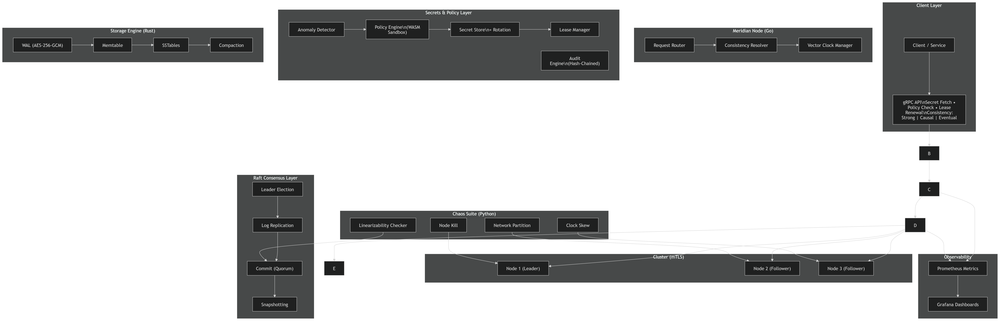

# Meridian — Per-Request Consistency over a Shared Keyspace

<div align="center">


[](https://github.com/nickemma/meridian/actions)

**A geo-distributed key-value store in which the replication mechanism is chosen per request — Raft for strong, vector-clock dependency tracking for causal, asynchronous gossip for eventual — over one keyspace and one storage engine.**

[Project status](#project-status) • [Research protocol](docs/research.md) • [API and run guide](API.md) • [Roadmap](docs/ROADMAP.md)

</div>

---

## The question

Choosing consistency per operation is established prior work. Dynamo-style stores vary read and write quorums, Pileus selects replicas against consistency–latency SLAs, and RedBlue consistency separates operations by whether they need a common order. In each case, one replication design is varied by a parameter.

Meridian runs three **structurally different** mechanisms over the same keys. That raises questions a quorum parameter never does:

- What is a client promised when a key written through consensus is read through gossip?
- Is a Raft-committed dependency visible to a causal read, and what does the read do while it is not?
- What resolves a race between a strong write and an eventual one?
- Does the flexibility pay — against the best fixed mechanism that still satisfies every operation — and what does it cost when a deployment uses only one path?

[`docs/research.md`](docs/research.md) fixes the cross-mechanism contract, hypotheses, baselines, workloads and acceptance gates **before** any measurement, so results cannot be retrofitted to the design. No performance result is claimed yet.

---

## Project status

Every component is listed with its real state. Vocabulary: **Working** · **Partial** (what is missing, in one clause) · **Designed, not built**.

### Distributed key-value core

| Component | State |
|---|---|
| Raft — leader election, log replication, commit rules, durable hard state | **Working** — unit tests plus a live three-node leader-stop / restart / catch-up integration test |
| Raft — pre-vote extension | **Working** — unit tests |
| Raft — log compaction / snapshots | Designed, not built |
| Rust LSM engine — WAL, memtable, SSTables, tombstones, crash recovery | **Working** — 25 Rust tests; used by Go through a C ABI |
| LSM compaction | **Partial** — explicit full compaction only; no leveled or background compaction |
| LSM bloom filters | Designed, not built |
| WAL encryption at rest | Designed, not built |
| Strong path | **Working** — reads use a committed no-op barrier, not ReadIndex (the extra log entry is a known cost) |
| Causal path | **Working** — vector clocks plus applied-Raft-index dependency checks; reads wait until their deadline, then return `DEADLINE_EXCEEDED` rather than expose a value ahead of its dependency |
| Eventual path | **Working** — multi-value registers, immediate async push, 250 ms anti-entropy retransmit; concurrent siblings returned to the client |
| Cross-mechanism contract | **Partial** — one write class per namespace is enforced and strong writes are materialized for weak reads; namespace policies are fixed at startup (not Raft-installed) and there is no durable gossip outbox |
| Client API (`Get` / `Put` / `Delete` / `CompareAndSet` / `Status`) and leader-aware Go client | **Working** |
| Inter-node TLS / authentication | Designed, not built — peer gRPC is currently plaintext |

### Verification and measurement tooling

| Component | State |
|---|---|
| Linearizability checker (`cmd/meridian-check`) | **Partial** — exhaustive search over bounded single-register histories; a smoke checker, not a large-history checker |
| Closed-loop load driver (`cmd/meridian-load`) | **Working** — JSONL operation histories and percentile summaries |
| Open-loop driver (`cmd/meridian-openload`) | **Working** — schedules the pre-registered mixed workload at a target offered rate |
| Staleness analysis (`cmd/meridian-staleness`) | **Partial** — lower-bound staleness from histories; no acknowledgement-to-visibility measure |
| Chaos suite (`chaos/`) | **Partial** — node kill, partition and clock-skew scenarios against the Docker cluster; no retained runs |
| Prometheus metrics | **Working** — 17 metrics per node on `client port + 1000`; Grafana is an optional Compose profile with no provisioned dashboards |
| External baselines (etcd, Cassandra) | **Partial** — reference deployments start; no measurements |
| Evaluation (research questions Q1–Q3) | Not run |

### Secrets and policy layer

These packages exist with unit tests but are **not yet mounted on the running node** — a package is not counted as shipped until it is reachable through the real client path.

| Component | State |
|---|---|
| Secret store — versioning, rotation with grace period, leases with TTL | **Partial** — in-process library with Raft-ready command encoding; not wired into the node |
| Policy engine — deny-by-default, contextual rules (identity, path, action, source IP, time) | **Partial** — evaluated natively in Go; not wired into the node |
| Policy sandboxing in WebAssembly, policy DSL compiler | Designed, not built |
| Audit log — SHA-256 hash chain with verifier | **Partial** — library; not yet committed through Raft |
| Access anomaly detection | **Partial** — rule-based per-identity detector (request-rate threshold over a 5-minute window, unseen source IP, unseen path); library only |
| Dynamic per-service credentials | Designed, not built |

---

## What testing has found

Building the live three-node leader-failover test exposed three Raft defects that unit tests had not:

1. **Concurrent vote handlers could grant two votes in one term** — a safety violation that can elect two leaders. State-changing Raft RPCs are now serialized (`TestHandleRequestVoteGrantsAtMostOneVotePerTerm`).
2. **Overlapping replication rounds could transiently separate a follower's commit index from its log.** Replicated suffixes are now merged atomically.
3. **A heartbeat could acknowledge an unrelated follower suffix.** The leader now counts only the prefix confirmed by an `AppendEntries` request.

Each has a regression test. Details: [`docs/research.md` §5.5](docs/research.md#55-september-11-implementation-update).

---

## Architecture



The diagram shows the target system, including the secrets layer. The tables above say which parts of it are built.

**Request flow.** A client names a consistency class on each request. Namespaces are bound to one write class at startup (`/strong/`, `/causal/`, `/eventual/` in the development cluster); a write to the wrong class is rejected with `FAILED_PRECONDITION` and no mutation.

- **Strong** — the request enters the Raft log on the leader. A strong read commits a no-op barrier before answering.
- **Causal** — the request carries a vector-clock context. A replica exposes a value only once its dependencies, including any Raft index, have been applied locally.
- **Eventual** — the request is applied to a multi-value register and disseminated by gossip; concurrent writes are returned as siblings rather than silently resolved.

After a strong write applies, its record is materialized into the weak-path registers so a causal or eventual read of a strongly written key returns a version that carries its Raft index.

---

## Quick start

Prerequisites: Go 1.26, Rust 1.87, Python 3.12 (chaos suite), Docker with Compose.

```bash
git clone https://github.com/nickemma/meridian.git
cd meridian

# Unit tests (Go, race detector) and the Rust storage engine
make test
cd storage-engine && cargo test && cd ..

# Live three-node strong-path integration test (leader stop, restart, catch-up)
make test-strong-integration

# Start a three-node cluster: client gRPC on :8081–8083, metrics on :9081–9083
make cluster-up

# Smoke-test the strong path against the leader, then check the history
go run ./cmd/meridian-load -target localhost:8082 -consistency strong \
  -policy-version 1 -operations 16 -concurrency 1 -read-percent 50 \
  -raw /tmp/strong-history.jsonl
go run ./cmd/meridian-check -history /tmp/strong-history.jsonl -limit 20

# Chaos scenarios (destructive; isolated Docker network)
make chaos-run

make cluster-down
```

[`API.md`](API.md) has the full run guide: finding the leader, namespace policies, the gRPC contract, a Go client example, error handling and the open-loop research driver.

---

## Repository layout

```text
meridian/
├─ cmd/
│  ├─ meridian/            node binary
│  ├─ meridian-load/       closed-loop driver
│  ├─ meridian-openload/   open-loop driver for the pre-registered workload
│  ├─ meridian-check/      bounded linearizability checker
│  └─ meridian-staleness/  staleness analysis over histories
├─ internal/
│  ├─ raft/                consensus, pre-vote, durable state
│  ├─ consistency/         per-request class selection and admission
│  ├─ causal/  eventual/   weak-path replicas
│  ├─ server/              client and peer gRPC services, Rust-backed state machine
│  ├─ storage/  replicationstore/  config/  metrics/
│  └─ secrets/  policy/  audit/  anomaly/   secrets layer — not yet mounted
├─ storage-engine/         Rust LSM engine and C ABI
├─ client/                 leader-aware Go client
├─ proto/                  kv, raft and causal gRPC contracts
├─ chaos/                  Python chaos orchestrator and scenarios
├─ bench/workloads/        pre-registered mixed workload
├─ infra/                  Docker Compose cluster, Prometheus, baselines
└─ docs/                   research protocol, roadmap, design documents
```

---

## Documentation

| Document | Contents |
|---|---|
| [`docs/research.md`](docs/research.md) | Pre-registered research protocol: questions, cross-mechanism contract, hypotheses, baselines, gates |
| [`docs/ROADMAP.md`](docs/ROADMAP.md) | Code status per area and what is missing before any research claim |
| [`API.md`](API.md) | Run guide, gRPC contract, client example, current limits |
| [`docs/DESIGN_DOC.md`](docs/DESIGN_DOC.md), [`docs/ARCHITECTURE.md`](docs/ARCHITECTURE.md), [`docs/TRADEOFFS.md`](docs/TRADEOFFS.md) | Design documents for the target system, written April 2026; they describe components that are not yet built |
| [`docs/RUNBOOK.md`](docs/RUNBOOK.md) | Operating procedures |

---

## Non-goals

- **Not a general-purpose database.** The consistency options exist to study their composition.
- **Not production software.** No TLS, authentication, backup or recovery procedure yet.
- **Not highly available under quorum loss on the strong path.** Strong requests fail closed by design; weak paths keep serving with their weaker contracts.

---

## Related repositories

[LATTICE](https://github.com/nickemma/lattice) — distributed search with explicit coverage under partial failure.

---

## Author

**Nicholas Emmanuel** · [@nickemma](https://github.com/nickemma)

<div align="center">
<a href="https://www.linkedin.com/in/techieemma/"></a>
<a href="https://twitter.com/techieemma"></a>
<a href="https://github.com/nickemma/"></a>
<a href="https://techieemma.medium.com/"></a>
<a href="mailto:nicholasemmanuel321@gmail.com"></a>
</div>
